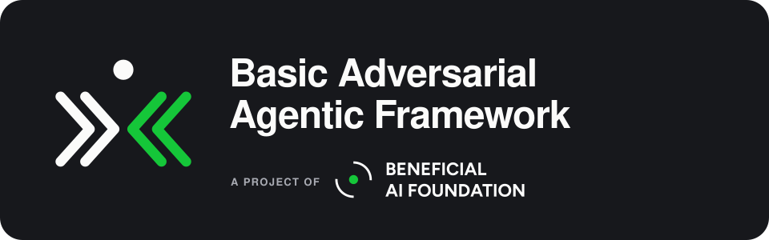

<p align="center">
  
</p>

# basic-adversarial-agentic-framework

A Lean 4 package of adversarial Claude agents. Two pairs of agents with
opposed roles create and review a pull request that carries Lean code for a
mathematical issue in prose. A supervisor agent repeats both phases until it
decides. The Lean checker judges each version of the code.

The page of the package on Veriapps is
https://veriapps.org/apps/adversarial-agents.

The package builds on [lean-aibackend](https://github.com/Beneficial-AI-Foundation/lean-aibackend),
which provides the Claude API client, the Claude CLI backend, the key handling
and the TLS checks.

**Platforms.** The package works on macOS. Linux and Windows are work in
progress, since the build of `lean-aibackend` fails on Linux at the link step
today, and Windows has no default key helper there.

The repository is `basic-adversarial-agentic-framework`, the Lake package is
`adversarial`, and the library to import is `Adversarial`.

## Installation

**The package works on macOS only.** Linux and Windows are work in progress.

The package needs the tools of `lean-aibackend`, which its README lists.

| Tool | Requirement |
| --- | --- |
| `elan` | Installs the Lean version of `lean-toolchain`, and `lean` for the scenarios |
| A C compiler, as `cc` | Builds the C shim of `lean-aibackend` |
| libcurl | Version 7.85.0 or later, with TLS support, its headers and `curl-config` |
| `python3` with the `ssl` module, and `openssl` | Run the scenarios |

The command `curl-config --version` prints the version of libcurl. Ubuntu
22.04 ships libcurl 7.81.0, so `lake test` stops at the libcurl check there.
On macOS the Command Line Tools for Xcode provide every tool but `elan`.

```
git clone https://github.com/Beneficial-AI-Foundation/basic-adversarial-agentic-framework.git
cd basic-adversarial-agentic-framework
lake test
```

The command `lake test` fetches `lean-aibackend`, builds the package and runs
the scenarios with simulated assistants. It needs no API key and no Claude
CLI.

A run with real agents needs one of the two Claude backends.

| Backend | Requirement |
| --- | --- |
| `ffi` | An Anthropic API key in the secret store. On macOS the command `security add-generic-password -a "$USER" -s lean-aibackend-anthropic-api-key -w` stores it. |
| `cli` | The `claude` CLI, already logged in |

## Quick start

The executable `prove` runs the flow with five real Claude agents per issue.
The backend is `ffi` unless the second argument says `cli`. Without an API key
in the secret store, `prove` with the backend `ffi` stops before the first
issue. A user of the Claude CLI therefore passes `cli`.

```
lake exe prove examples ffi 12        # one example issue, through the API
lake exe prove examples cli 12        # the same issue, through the Claude CLI
lake exe prove examples               # every example issue, through the API
lake exe prove book/claims.json       # the claims of the book, through the API
lake exe prove book/claims.json cli   # the claims of the book, through the Claude CLI
lake exe prove <issues.json> [ffi|cli] [number|all] [maxTokens]
```

The book has results for 17 of its 18 claims, so a run on it repeats only
Art. 253 Cor.

A run prints one row per issue and writes three kinds of files.

| File | Content |
| --- | --- |
| `<name>.lean` | The Lean code that the supervisor accepted |
| `<name>.thread.md` | The whole discussion of the five agents |
| `summary-<backend>.md` | One row per issue, with the status, the supervisor rounds and the objections |
| `usage-ffi.md` | One record per call of an agent over the API backend, with its output tokens, its stop reason and its duration |

The results of the examples go to `examples/results`. The results of a file
go to the directory `results` beside it. A run skips an issue whose thread
file exists, so an interrupted run resumes. A run with real agents spends
tokens.

A file of issues is a JSON array. Each issue has the fields `number`, `title`,
`text` and `theoremName`. The text is prose with mathematics. The theorem name
consists of letters, digits and underscores.

## Agents

The module `Adversarial.Agent` holds the agents.

| Declaration | Role |
| --- | --- |
| `Agent` | A Claude backend with a name and standing instructions |
| `Agent.apiOwn name instructions` | An agent over the API backend with a client of its own, hence a connection of its own |
| `Agent.api c name instructions` | An agent over the API backend that uses the connection of the client `c` |
| `Agent.cli name instructions` | An agent over the CLI backend, where each call is one isolated process |
| `Thread`, `Turn` | The conversation that several agents share, with one header line per turn |
| `Agent.reply` | The agent reads the thread and adds one turn |
| `Pair` | Two adversarial agents, a proponent and an opponent |
| `Pair.debate` | Rounds of proposal, optional check and attack, until the check accepts the proposal and the opponent yields |

Agents share no connection. Each `Agent.apiOwn` agent owns one client. Each
call of an `Agent.cli` agent starts one `claude -p` process with the options
`--no-session-persistence` and `--tools ""`. The process saves no session, and
the model has no tool, so it can neither read nor write a file or a memory.
The thread is the only channel between agents. The CLI still loads the
instruction files of the user at its start, such as `CLAUDE.md`. That content
is the same for every agent. No run tested whether a CLI option excludes it.

The function `Thread.render` gives a leading space to any line of a turn that
starts like a header. A turn therefore cannot forge the header of another
speaker.

## Generic flow

The module `Adversarial.Flow` holds a flow of `n` phases. In each phase a
supervisor manages a set of agents over rounds. A flow with one phase runs the
same code as a flow with several phases.

In a round the author of the phase, if the phase has one, writes the work, and
the check of the phase reports on it. Each active agent then replies. A reply
that starts with `NO OBJECTION`, after any marks such as `**`, has no
objection, and any other reply is an objection. The supervisor replies last,
and the first word of its reply is the decision. A phase may name each
decision by words of its own, as the review of the pull request flow does
with `MERGE`, `REVISE` and `REJECT`. A rule supervisor decides by a function
of the round and adds no turn. Every speaker of a phase has
a plain name of letters, digits, `_` and `-`, so a `DROP` line can name it.

| Decision | Effect |
| --- | --- |
| `CONTINUE` | Another round. It requires an objection or a failed last check. The supervisor drops every agent without objection and the agents of its `DROP a, b` lines |
| `ACCEPT` | The next phase, or the status `accepted` after the last phase. The flow refuses the final acceptance while the last check failed, and the latest phase with an author writes the work again |
| `BACK` | An earlier phase, the one that a line `PHASE name` names or else the previous one. The phase starts again with all its agents |
| `REJECT` | The status `rejected` |

When the drops would leave fewer agents than `minAgents`, no agent leaves. A
phase whose check is not `binding` reports a failed check as evidence only.
The field `onDecision` of a flow runs an action after each decision, with the
state so far. A
phase that reaches `maxRounds` rounds, or a flow that reaches
`maxVisits` visits, ends with the status `undecided`. Any other reply of a
supervisor raises an `IO` error.

The outcome holds the thread and one `Entry` per turn, with the flow, the
phase, the visit, the round, the speaker, the text, the kind of the turn, the
active agents and the duration. The entries hold no output tokens, since
`Backend.ask` returns only the text of a reply.

## Pull request flow

The module `Adversarial.PullRequest` holds the flow. An issue is prose with
mathematics. It fixes only the name of the Lean theorem. Five agents take
part.

| Agent | Pair | Role |
| --- | --- | --- |
| prover | authors, proponent | Writes the Lean code |
| challenger | authors, opponent | States its strongest objection to the code, for instance a statement that differs from the prose |
| critic | reviewers, proponent | Argues that the code must not be accepted |
| defender | reviewers, opponent | Rebuts the critic |
| supervisor | none | Reads the thread and replies `MERGE`, `REVISE` or `REJECT` |

The flow is a `Flow` of two phases, and each round of the supervisor visits
both.

1. Phase `pr`. The authors debate. After each version of the code the Lean
   check reports on the thread. A rule supervisor ends the phase when the
   check passes and the challenger has no objection, or after three rounds.
   It adds no turn.
2. Phase `review`. The reviewers debate the code once, and the supervisor
   decides. `REVISE` returns to the phase `pr`. `MERGE` takes effect only when
   the Lean check accepted the last version of the code. Otherwise the flow
   reports the refusal and returns to the phase `pr`. The flow ends with the
   status `undecided` after four rounds.

The outcome holds the entries of the generic flow, one per turn.

The status `merged` records the decision `MERGE` of the supervisor. The flow
performs no git operation. It writes the accepted code to a file.

The Lean check has three parts. A text filter refuses code that contains one
of 16 texts, such as `#eval`, `macro` or `unsafe`, and code with a line that
starts with `import`. The filter also matches inside a comment. The command
`lean --stdin` then elaborates the code. Last, `#print axioms` must report no
axiom outside `propext`, `Classical.choice` and `Quot.sound`, which excludes
`sorry` and a new axiom.

The Lean check does not compare the statement with the prose. That comparison
is the task of the challenger, of the reviewers and of the supervisor. An
accepted file is therefore a proof that Lean checked, of a statement that
agents judged faithful. No person reviewed that judgment.

| Declaration | Role |
| --- | --- |
| `Issue` | Prose with mathematics, and the name of the Lean theorem |
| `Checker`, `leanCheck` | The Lean check. The default runs `lean --stdin`, with a time limit of 300 seconds, so the code uses the Lean core library only |
| `pullRequestFlow` | The flow, for two pairs and a supervisor |
| `prPhase`, `reviewPhase` | The two phases of the flow |
| `Team`, `Team.api`, `Team.cli` | The five agents with their instructions, over the API backend or the CLI backend |
| `Team.run` | The flow of one issue with a team |
| `proveIssues`, `proveClaims`, `loadIssues` | The flow on a list of issues or on a JSON file, with saved results |

A program calls the flow like this.

```lean
import Adversarial
open Adversarial

def main : IO Unit := do
  let issue : Issue := {
    number := 1
    title := "The sum of two even numbers is even"
    text := "A natural number n is even when n = 2k for some natural number k. " ++
      "Prove that the sum of two even natural numbers is even."
    theoremName := "even_add_even" }
  let outcome ← (← Team.api).run issue
  IO.println s!"{outcome.status.name} after {outcome.rounds} rounds\n{outcome.code}"
```

## Example issues

The module `Adversarial.Examples` holds eleven issues. Two claims are false,
so a correct flow ends them with a rejection.

| Number | Issue | Claim |
| --- | --- | --- |
| 12 | The sum of two even numbers is even | true |
| 15 | n + 1 = n for every natural number n | false |
| 21 | No rational number has square 2 | true |
| 22 | For every natural number n there is a prime p with p > n | true |
| 23 | n² + n + 41 is prime for every natural number n | false, at n = 40 |
| 24 | Among six people, three all know one another or three are mutual strangers | true |
| 25 | Every natural number n ≥ 2 has a factorization into primes, unique up to order | true |
| 26 | Fermat's little theorem | true |
| 27 | x² + y² ≥ 2xy for all real numbers, with equality exactly when x = y | true |
| 28 | The pigeonhole principle | true |
| 29 | Every non-increasing sequence of natural numbers is eventually constant | true |

Seven issues ran with real agents. Issues 25, 26, 28 and 29 have not run.

| Number | Backend | Outcome | Supervisor rounds |
| --- | --- | --- | --- |
| 12 | API, and CLI | merged | 1 |
| 15 | API | rejected | 1 |
| 21 | API | merged, with a type of rational numbers that the code defines | 1 |
| 21 | CLI | merged, with the type `Rat` of the core library | 4 |
| 22 | API | merged | 1 |
| 23 | API | rejected | 1 |
| 24 | API | merged | 1 |
| 27 | API | merged | 3 |

The runs of issues 22 and 23 used earlier instructions, under which the
challenger and the critic could agree at once. Both agreed, and neither run
shows an objection. The outcomes of a rerun can differ, since the agents are
not deterministic.

## The book

The directory `book` holds a larger example. Its claims are 18 propositions of
H. S. Hall and S. R. Knight, "Higher Algebra", Fourth Edition, Macmillan,
1891. The scan is at https://archive.org/details/higheralgebraseq00hall. The
title page of the scan carries the year 1891, so the book is in the public
domain in the United States. Its status in other countries is not verified.
The evidence that the book saw wide use is weak and indirect. It consists of
reprints and library records in several countries, with no adoption figures.
The file `book/source.json` records the source and this evidence.

The file `book/claims.json` holds the claims. The text of each claim has four
parts. They are a line with the source, the definitions that the book prints
for the article, the statement that the book prints, and the sentence "State
the result of this article as a Lean theorem and prove it." The mathematical
notation is a transcription into plain text, such as `a^x` for a power. An
agent typed each statement from a page image of the scan. Two of the 18, Art. 40 and Art. 111,
have a second comparison with the page images. Five claims record, in the
field `gaps`, a condition that the book does not print, such as r ≠ 1 in
Art. 55. The agents do not see that field.

The directory `book/results` holds the results of two runs through the API
backend. The first run used a limit of 32000 tokens per reply. The second run
repeated the three claims that ended with an error, with a limit of 64000.

| Art. | Topic | Status | Supervisor rounds | Objections of the challenger |
| --- | --- | --- | --- | --- |
| 40 | Sum of an arithmetical progression | merged | 3 | 2 |
| 55 | Sum of a geometrical progression | merged | 1 | 1 |
| 57 | Sum to infinity of a geometrical progression | merged | 2 | 2 |
| 65 | The relation AH = G² between the three means | merged | 1 | 1 |
| 68 | Sum of the squares of the first n natural numbers | merged | 2 | 2 |
| 69 | Sum of the cubes of the first n natural numbers | merged | 1 | 1 |
| 111 | Solution of the quadratic equation | merged | 1 | 1 |
| 113 | Nature of the roots of the quadratic equation | merged, in the second run | 3 | 4 |
| 114 | Sum and product of the roots | merged | 2 | 2 |
| 163 | Binomial theorem for a positive integral index | merged | 1 | 2 |
| 204 | Logarithm of a product | merged | 1 | 1 |
| 205 | Logarithm of a fraction | merged | 2 | 2 |
| 206 | Logarithm of a power | merged | 1 | 2 |
| 246 | Properties of an inequality | merged | 2 | 1 |
| 250 | Arithmetic and geometric mean of two quantities | merged, in the second run | 3 | 2 |
| 253 Cor. | Arithmetic and geometric mean of n quantities | error, in both runs | | |
| 514 | Remainder of a division by x − a | merged | 1 | 1 |
| 514 Cor. | Its corollary | merged | 2 | 3 |

### The token limit and the second run

In the first run three claims ended with an error. Each time a reply of an
agent reached the limit of 32000 tokens, and the client raises an error on an
incomplete reply. The output tokens of a reply include the thinking of the
model.

The second run repeated those three claims with a limit of 64000 tokens. The
choice of that value rests on two measurements of the second run itself, which
recorded each call of an agent in `book/results/usage-ffi.md`.

1. The need. Five of the 16 replies of the prover held more than 32000 tokens.
   Four of them were complete, and the largest of those held 51100.
2. The ceiling. The client does not stream, and a request ends after 600
   seconds. The 11 replies of the prover above 15000 tokens arrived at 108 to
   156 tokens per second. Over all 16 replies the rate was 121. At the lowest
   rate, 600 seconds hold 64800 tokens. The one reply that reached 64000
   tokens took 549 seconds.

| Claim | Result of the second run | Largest reply of the prover |
| --- | --- | --- |
| Art. 113 | merged in the third supervisor round | 51100 tokens |
| Art. 250 | merged in the third supervisor round | 29744 tokens |
| Art. 253 Cor. | error. The third reply of the prover reached 64000 tokens after 549 seconds | 64000 tokens, incomplete |

Art. 253 Cor. remains without a result. A higher limit is not usable with the
present client, since a reply above about 64800 tokens can exceed the request
limit of 600 seconds. The claim needs a client that streams, a longer request
limit or shorter replies. No run tested any of the three.

In the second run the largest reply for Art. 250 held 29744 tokens, below the
old limit of 32000. The first run of that claim had failed at 32000. The
replies of the two runs differ, since the agents are not deterministic.

### Token usage of the second run

The run made 49 requests, all with HTTP status 200. It produced 435705 output
tokens in 3722 seconds of request time. The records hold output tokens only.
The first run wrote no usage records.

| Agent | Calls | Output tokens | Share | Largest reply | Mean reply | Tokens per second |
| --- | --- | --- | --- | --- | --- | --- |
| prover | 16 | 393081 | 90.2 % | 64000 | 24567 | 121 |
| challenger | 15 | 14259 | 3.3 % | 1847 | 950 | 85 |
| critic | 6 | 14096 | 3.2 % | 3174 | 2349 | 94 |
| defender | 6 | 9112 | 2.1 % | 2144 | 1518 | 92 |
| supervisor | 6 | 5157 | 1.2 % | 1027 | 859 | 83 |

| Claim | Calls | Output tokens | Request seconds | Tokens of the prover |
| --- | --- | --- | --- | --- |
| Art. 113 | 23 | 224201 | 1879 | 203938 in 7 replies |
| Art. 250 | 21 | 87471 | 785 | 66235 in 6 replies |
| Art. 253 Cor. | 5 | 124033 | 1058 | 122908 in 3 replies |

The prover produced nine tenths of the output tokens. Every other agent
stayed below 3200 tokens per reply.

### Fidelity of the accepted statements

Several accepted statements are abstract, since the Lean core library has no
real numbers. Art. 113 holds over a field of the core library with an order
structure that its file defines. Art. 250 holds over a class of ordered
fields that its file defines. Art. 111 holds over a field, with the hypotheses a ≠ 0 and
2 ≠ 0. Art. 204 holds for any operation with three assumed laws of a power.
Art. 57 states the sum to infinity through an inequality on integers. The
fidelity of each encoding rests on the judgment of the agents.

The test suite checks that each of the 17 accepted files still passes the
Lean check.

## Use from another Lake project

Another project requires the package in its `lakefile.lean`. Lake passes the
C shim of `lean-aibackend` on, but not the libcurl link arguments, so each
executable repeats them.

```lean
require adversarial from git
  "https://github.com/Beneficial-AI-Foundation/basic-adversarial-agentic-framework.git" @ "main"

def curlLinkArgs : Array String :=
  if Platform.isOSX then
    #["-L", run_io do
      let out ← IO.Process.output { cmd := "xcrun", args := #["--show-sdk-path"] }
      return out.stdout.trimAscii.toString ++ "/usr/lib", "-lcurl"]
  else #["-lcurl"]

lean_exe myapp where
  root := `MyApp
  moreLinkArgs := curlLinkArgs
```

No project has required this package by `git` yet, so the snippet above has
not run. The same form ran for `lean-aibackend`.

The agents over the API backend work in a compiled executable only, since
that backend uses native code. A run showed this for the backend. The CLI
backend of `lean-aibackend` works in the interpreter. No run tested an
`Agent.cli` of this package there.

This package names the toolchain v4.36.0, and it has run under no other
toolchain. Among the 17 accepted files of the book, four use
`Lean.Grind.Field` and three use `Rat`.

## Tests

The command `lake test` first runs the 29 tests of the generic flow in
`tests/FlowTests.lean`, with scripted agents and no backend. They cover flows
of one, two and three phases, the returns to earlier phases, the drops of
agents and the floor `minAgents`, the limits of rounds and visits, each
decision, the replies outside the protocol, the failure of the check, the
errors of agents, the names of speakers, rule supervisors, the decision words
of a phase, the return after a refused acceptance and the entries of the
thread.

The command then runs the 21 tests of the pull request flow in
`tests/PullRequestTests.lean`, with scripted agents and the Lean of the
toolchain. They cover `MERGE`, `REVISE` and `REJECT`, a merge without a
passing Lean check, the limits of rounds, the end of the phase `pr`, a forged
header, the replies outside the protocol, the preconditions, every case of
the Lean check, the entries of the thread and the summary of `proveIssues`.

Last, the command runs six scenarios with the deterministic simulated
assistants of `tests/mock_server.py`, through the `Claude.Api` client and TLS.

| Scenario | Content |
| --- | --- |
| Pull requests | The flow with scripted agents. One issue merges in the second round, after an unfinished proof, a different statement and a vacuous hypothesis. A false issue ends with `REJECT`. Further cases cover a merge without a passing check, a supervisor outside the protocol, a forged header, the preconditions of a debate and the Lean check. Each scripted agent has a connection of its own, which the scenario verifies. |
| Calculator agent | A tool loop of an agent, on 150 generated tasks |
| Agent failures | The same loop with an unknown tool, wrong arguments, an endless assistant, a reply outside the protocol and a refusal |
| Tool use blocks | A tool loop over `tool_use` and `tool_result` blocks, with a forged history as the negative case |
| Parallel workers | Eight agents in parallel, each with its own client |
| Book | The 17 accepted Lean files of the book pass the Lean check |

The variable `AIBACKEND_LIVE` adds runs of the flow with five real Claude
agents, on the example issue whose number `AIBACKEND_ISSUE` holds. The value
`ffi` or `cli` selects one backend.

The following ran from a clone without credentials on macOS. The command
`lake test` passed. The commands `lake exe prove examples ffi 12` and
`lake exe prove examples ffi 15` ended with "merged" and "rejected". The
command `lake exe prove examples cli 12` ended with "merged" in the
development directory. The workflow of the repository runs `lake test` on
macOS, on a machine without an API key and without the Claude CLI.

## Layout

- `Adversarial/Agent.lean` — agents, threads and adversarial pairs.
- `Adversarial/Flow.lean` — the generic flow of `n` phases.
- `Adversarial/PullRequest.lean` — the flow, the Lean check, teams and the runs on issues.
- `Adversarial/Examples.lean` — the example issues.
- `Prove.lean` — the executable `prove`.
- `book/` — the claims of the book and the results of one run.
- `tests/Harness.lean` — the helpers of the tests with scripted agents.
- `tests/FlowTests.lean` — the tests of the generic flow.
- `tests/PullRequestTests.lean` — the tests of the pull request flow.
- `tests/Scenarios.lean` — the scenarios.
- `tests/mock_server.py` — the mock of the Messages API, with the simulated assistants.

## Limits

- The list of forbidden commands in the Lean check is a filter, not a sandbox.
  A run with real agents elaborates Lean source that a model wrote.
- The code of an issue uses the Lean core library only, since the default
  check runs without Mathlib.
- The flow has a limit of four supervisor rounds and of three rounds per
  debate of the authors.
- The flow does not retry a request. A rate limit or an overload of the API
  ends the current issue with the status `error`.
- A run has no spending cap. One claim of the book used 224201 output tokens.
- The usage records hold output tokens only, and only for the API backend.
- The agents are not deterministic, so two runs of one issue can differ.
- A reply of an agent over the API backend has a limit of 64000 tokens, which
  includes the thinking of the model. A larger reply does not fit in one
  request of 600 seconds, as the section on the token limit explains.

## Logo

The directory `assets` holds the logo. The file `banner.svg` shows the mark
with the name and the logo of the Beneficial AI Foundation, on a dark ground.
The files `logo.svg` and `logo-dark.svg` hold the mark alone, for a light and
for a dark ground. The green is `#15C639`, the green of the foundation's logo.
The text of the banner uses the typeface Manrope where the viewer has it, and
a system sans serif otherwise.

## License

The package is under the MIT license. See the file `LICENSE`.
